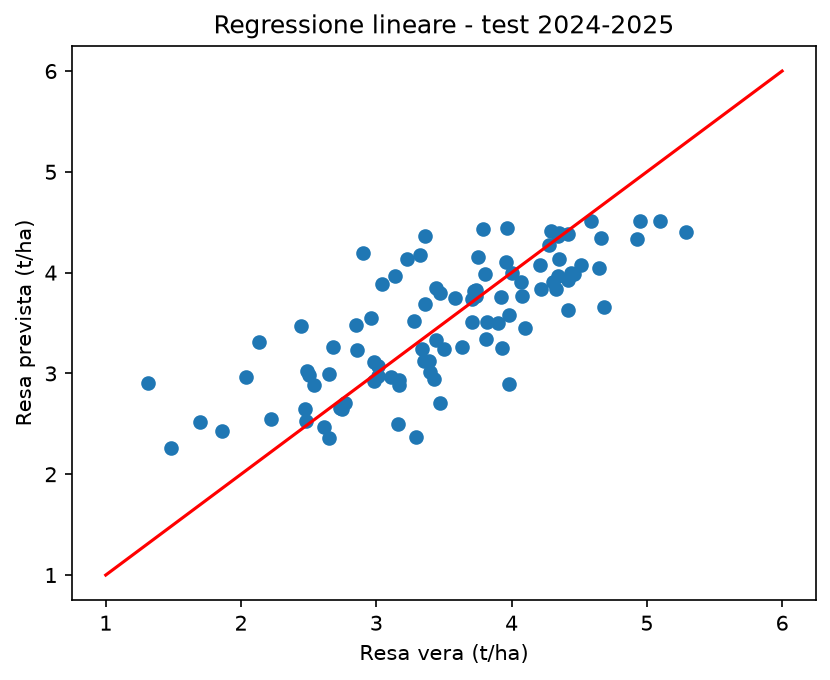

# Previsione della resa del grano duro a fine aprile

## In breve
Modello per stimare a fine aprile la resa del grano duro di 60 campi di una cooperativa sarda, per organizzare in anticipo stoccaggio e vendite. Una regressione lineare con NDVI di aprile, pioggia, azoto, varietà e suolo stima la resa con un errore medio di **0,42 t/ha**, il 40% in meno rispetto alla media degli anni passati (0,71 t/ha). Una Random Forest non migliora il risultato, quindi è stato scelto il modello più semplice da interpretare.

## Dati
Dati simulati di 60 campi, dal 2018 al 2025 (410 campagne):
- **campagne_grano**: una riga per campo e anno, con varietà, azoto, pioggia nov-apr, temperatura apr-mag, NDVI massimo di aprile, proteina della granella, data di raccolta e resa;
- **campi**: comune, tessitura del suolo, ettari.

## Workflow
1. **Pulizia:** 14 campagne senza NDVI per copertura nuvolosa, escluse.
2. **Scelta delle variabili:** solo dati disponibili a fine aprile. Escluse la proteina della granella e la data di raccolta (data leakage), la temperatura di maggio, anno e id del campo (etichette che non generalizzano).
3. **Divisione per anno:** addestramento sul 2018-2023, test sul 2024-2025, per simulare la previsione di un anno mai visto.
4. **Riferimento:** errore della resa media degli anni passati.
5. **Modelli:** regressione lineare e Random Forest, confrontate sullo stesso test.
6. **Interpretazione dei coefficienti** della regressione lineare.

## Risultati

| Modello | Errore medio (t/ha) |
|---|---|
| Media degli anni passati (riferimento) | 0,71 |
| Regressione lineare | 0,42 |
| Random Forest | 0,42 |

Fattori associati alla resa, a parità delle altre condizioni:
- +100 mm di pioggia (nov-apr): +0,33 t/ha
- +0,1 di NDVI ad aprile: +0,28 t/ha (un buon segnale precoce della resa)
- +20 kg/ha di azoto: +0,06 t/ha
- suolo franco rispetto ad argilloso: +0,45 t/ha; suolo sabbioso: −0,32 t/ha
- varietà Iride e Marco Aurelio rispetto ad Antalis: +0,19 e +0,15 t/ha

## Limiti
- Il modello non conosce il meteo dopo aprile, come il caldo di maggio durante il riempimento della granella, che spiega parte dell'errore.
- I coefficienti indicano associazioni, non effetti causali: per valutare l'effetto reale dell'azoto o della varietà servono prove in campo.

## Strumenti
Python · pandas · scikit-learn · matplotlib